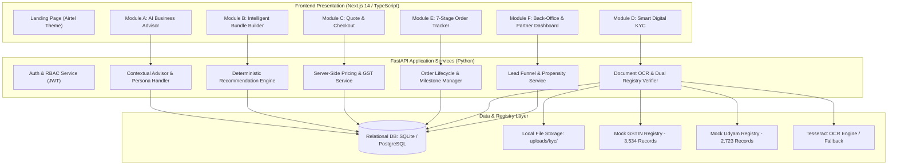
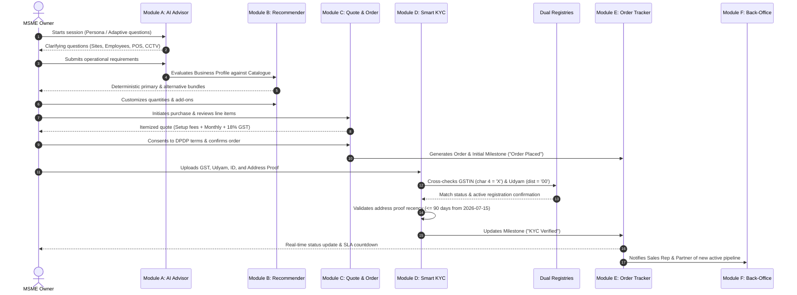

# System Architecture & Technical Design — Project Udyam Digital
**Accel Business | Airtel SYNC Hackathon 2026**

---

## 1. System Overview

Project Udyam Digital is structured as a **clean, modular monolithic architecture** combining a Next.js 14 frontend and a Python FastAPI backend. The modular monolith pattern was intentionally selected over microservices to eliminate unnecessary network latency, maintain transactional consistency across quotes, orders, and KYC records, and ensure rapid, dependable execution for MSME onboarding.

---

## 2. End-to-End Customer Journey Sequence

The onboarding journey seamlessly guides the business owner from requirement discovery to active service:

---

## 3. Component Boundaries & Responsibilities

### Module A: AI Business Advisor
- **Goal:** Replace manual sales discovery calls with intelligent, low-friction conversational profiling.
- **Design Pattern:** Hybrid state-machine and LLM intent extraction.
- **Fallback:** Deterministic heuristic dialog trees for Kirana, Clinic, and Multi-Site personas ensuring 100% uptime even without external LLM API availability.

### Module B: Intelligent Bundle Builder
- **Goal:** Transparent, flexible bundling grounded in the actual 25-product catalogue.
- **Core Rules:**
  - Connectivity dependency checks (e.g., Static IP `P11` requires Broadband `P01`/`P02`/`P03`).
  - City Tier filtering (`P03` Biz Fibre 1G restricted to Tier 1).
  - Minimum site validation (`P10` SD-WAN requires $\ge 3$ sites).
  - GSTIN requirement enforcement (`P12`, `P13`, `P14`, `P15`, `P21` locked without GSTIN).

### Module C: Quote & Checkout
- **Goal:** Zero hidden charges and compliant contracting.
- **Security:** Immutable server-side price recalculation (client-submitted prices are ignored).
- **Taxation:** Itemized 18% GST calculation applied consistently.

### Module D: Smart KYC
- **Goal:** Cut KYC drop-off from 32% to <10% with instant digital document verification.
- **Integrations:**
  - OCR extraction of GSTIN, Udyam registration, Signatory Name, and Document Issue Date.
  - Mock GSTIN registry lookup (validating the synthetic `X` PAN flag).
  - Mock Udyam registry lookup (validating district code `00`).
  - Address proof recency validation against the hackathon reference date (`2026-07-15`).

### Module E: Order Tracker
- **Goal:** Eliminate customer status chase calls (currently averaging 3.0 calls per lead).
- **Milestones:** Placed $\rightarrow$ KYC Verification $\rightarrow$ Verified $\rightarrow$ Serviceability Assessment $\rightarrow$ Installation Scheduled $\rightarrow$ Installation in Progress $\rightarrow$ Activated.

### Module F: Back-Office Dashboard
- **Goal:** Empower channel partners and enterprise sales teams to intervene where automation stalls.
- **Intelligence:** Real-time funnel metrics computed over the 5,000 lead dataset, segment distribution, and explainable Lead Propensity Scoring (0–100).
