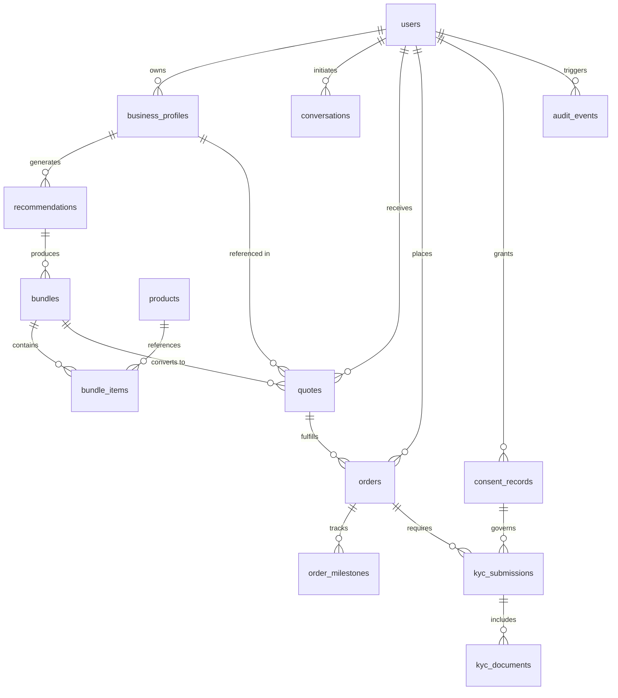

# Database Schema & API Reference — Project Udyam Digital
**Accel Business | Airtel SYNC Hackathon 2026**

---

## 1. Database Schema Specification

The database contains **15 relational tables** supporting the end-to-end MSME customer lifecycle.

### Table Dictionary

| # | Table Name | Description | Key Columns |
|---|---|---|---|
| 1 | `users` | Accounts & Role-Based Access | `id` (PK), `email` (Unique), `hashed_password`, `role`, `is_active` |
| 2 | `business_profiles` | MSME firmographic profiles | `id` (PK), `user_id` (FK), `business_name`, `segment`, `city_tier`, `has_gstin`, `employee_count` |
| 3 | `products` | Real 25-item catalogue | `id` (PK), `category`, `product_name`, `price_min`, `price_max`, `one_time_setup`, `requires_gstin` |
| 4 | `conversations` | AI Advisor chat sessions | `id` (PK), `user_id` (FK), `persona`, `status`, `messages` (JSON), `extracted_profile` (JSON) |
| 5 | `recommendations` | Output of recommendation engine | `id` (PK), `business_profile_id` (FK), `primary_bundle` (JSON), `total_monthly_inr`, `total_setup_inr` |
| 6 | `bundles` | Configured customer cart | `id` (PK), `name`, `business_profile_id` (FK), `total_monthly_inr`, `total_setup_inr`, `is_custom` |
| 7 | `bundle_items` | Individual line items in bundle | `id` (PK), `bundle_id` (FK), `product_id` (FK), `quantity`, `unit_price_inr`, `monthly_cost_inr` |
| 8 | `quotes` | Binding itemized price quotes | `id` (PK), `quote_number` (Unique), `line_items` (JSON), `total_monthly_inr`, `tax_pct`, `valid_until` |
| 9 | `orders` | Commercial customer orders | `id` (PK), `order_number` (Unique), `user_id` (FK), `quote_id` (FK), `status`, `payment_status` |
| 10 | `order_milestones` | 7-stage order lifecycle events | `id` (PK), `order_id` (FK), `stage`, `label`, `description`, `occurred_at`, `agent` |
| 11 | `kyc_submissions` | KYC packet per order | `id` (PK), `order_id` (FK), `status`, `overall_result`, `cross_check_results` (JSON) |
| 12 | `kyc_documents` | Uploaded document metadata | `id` (PK), `submission_id` (FK), `doc_type`, `stored_filename`, `extracted_fields` (JSON), `status` |
| 13 | `consent_records` | DPDP Act 2023 consent ledger | `id` (PK), `user_id` (FK), `purpose`, `consented` (Boolean), `ip_address`, `consented_at` |
| 14 | `leads` | Historical 5,000 lead dataset | `id` (PK), `segment`, `stage_reached`, `outcome`, `acquisition_cost_inr`, `propensity_score` |
| 15 | `audit_events` | Immutable security audit trail | `id` (PK), `user_id` (FK), `event_type`, `resource_type`, `resource_id`, `details` (JSON) |

---

## 2. API Endpoints Reference

### Authentication & User Management
- `POST /api/auth/register` — Register new customer account
- `POST /api/auth/login` — Authenticate and receive JWT bearer token
- `GET /api/auth/me` — Return authenticated user profile and assigned role

### Module A: AI Business Advisor
- `GET /api/advisor/personas` — Fetch pre-configured business personas (Kirana, Clinic, Multi-Site)
- `POST /api/advisor/start` — Start a new conversational session with initial persona greeting
- `POST /api/advisor/message` — Send customer response, process adaptive question, and return updated state

### Module B: Recommendations & Products
- `GET /api/products` — Retrieve all 25 catalogue products with pricing, setup fees, and constraints
- `GET /api/products/{id}` — Retrieve detailed product specs by ID (`P01` to `P25`)
- `POST /api/recommendations/generate` — Run deterministic bundling engine on a business profile

### Module C: Quotes & Orders
- `POST /api/quotes` — Create immutable quote with server-side price recalculation & 18% GST
- `GET /api/quotes/{id}` — Retrieve quote details and line-item breakdown
- `POST /api/orders` — Create order from approved quote and initialize 7-stage tracking milestone
- `GET /api/orders/{id}` — Fetch order summary, contract terms, and payment status

### Module D: Smart KYC & Document Verification
- `POST /api/kyc/upload` — Multipart document upload with OCR extraction
- `POST /api/kyc/verify` — Execute dual registry check (GSTIN + Udyam) and address proof age validation
- `POST /api/kyc/consent` — Record explicit, immutable DPDP Act 2023 customer consent

### Module E: Order Tracking
- `GET /api/orders/{id}/tracking` — Retrieve chronological order lifecycle milestones and SLA countdown

### Module F: Back-Office & Partner Intelligence
- `GET /api/leads` — Query, search, and filter 5,000 historical leads with pagination
- `GET /api/leads/funnel` — Retrieve real-time 6-stage funnel counts and conversion rates
- `GET /api/analytics/overview` — High-level KPI summary (Conversion %, CAC, Churn %, Average Bundle Value)
- `GET /api/analytics/bundle-popularity` — Top-selling bundles and product frequency analysis
- `GET /api/analytics/churn-analysis` — 6-month churn rate broken down by customer segment
- `GET /api/analytics/nps-distribution` — Net Promoter Score distribution across activated SMBs
